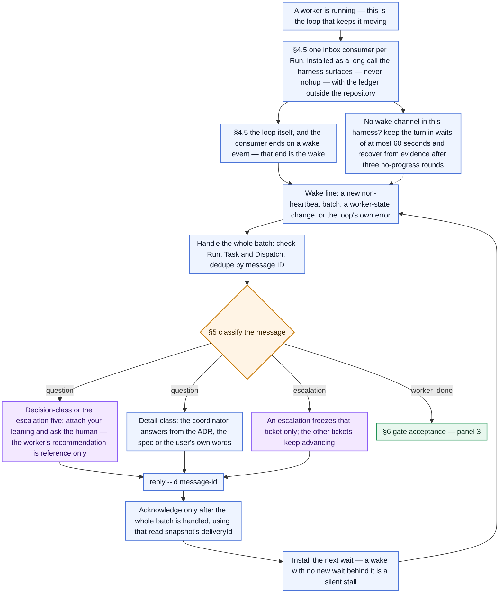
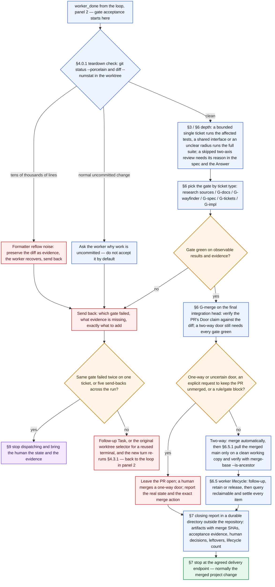

# orchestra-auto

A supervised Orca workflow for coordinating agent workers through safe gates, PR acceptance, and
reliable completion.

This repository publishes **two installable Agent Skills** that carry the same procedure in two
languages:

| Skill | Language | Install |
| --- | --- | --- |
| [`orchestra-auto`](skills/orchestra-auto/SKILL.md) | English | `npx skills add whutlichao/orchestra-auto --skill orchestra-auto` |
| [`orchestra-auto-zh`](skills/orchestra-auto-zh/SKILL.md) | 简体中文 | `npx skills add whutlichao/orchestra-auto --skill orchestra-auto-zh` |

Read [README.zh-CN.md](README.zh-CN.md) for the Chinese version of this document.

> **Orca prerequisite.** Both skills drive the **Orca CLI** (`orca orchestration …`). They are not a
> general agent-orchestration layer and do not work without Orca installed and its CLI reachable.
> See [Prerequisites and capability boundary](#prerequisites-and-capability-boundary) before you
> install.

## What it does

The coordinator plans, communicates and accepts; workers edit, commit and open PRs. Once the gates
pass, the coordinator merges — no per-ticket confirmation round trip. A complete ticket map goes
to one long-horizon `implement-spec` worker: it runs implementers in their own worktrees, merges
them into an integration branch, and opens one integration PR. The PR's Merge Danger decides the
last step: a two-way door auto-merges after G-merge, while a one-way door stays open for a human.
A process error, not a product bug, produces a read-only retro candidate list; the human selects
what a worker then lands.

The safety invariants the skill will not trade away:

- **Isolation**: every worker gets a fresh top-level worktree; a long-horizon worker's nested
  implementers each get their own worktree and branch, and the coordinator never edits or
  commits in a worker's worktree, never on the main working copy.
- **Real start evidence**: a `state: ready` receipt is not proof a turn began; the skill requires
  per-agent evidence (or `turnStart: observed`).
- **Live worker settings**: the worker harness comes from Orca's current settings, checked against
  the current disabled list — never from habit or a stale snapshot.
- **Message identity**: deliveries are persisted atomically by delivery ID, deduplicated, and
  acknowledged only after the whole batch is handled.
- **Decisions go to a human**: scope, approach forks and the escalation five (credentials, third
  parties, payment, manual approval, irreversible live-data operations) are never self-answered.
  A one-way Merge Danger door is also a human merge, not an automatic one.
- **Gates by ticket type**: a design ticket does not run source tests; an implementation ticket does
  not skip its review.
- **Acceptance before merge**: merges wait for the gate, and an unusual diff is preserved as
  evidence before anything is reverted. The door is verified against the diff, not trusted from
  the PR body.
- **Process errors leave a trail**: retro candidates are written outside the target repository and
  need human selection before a worker lands them.
- **Failure has a stop threshold**: bounded retries, a per-ticket breaker and a run-level breaker.
- **Lifecycle close-out**: settled workers are released, retained or handed a follow-up Task —
  nothing is silently abandoned.

## The flow, end to end

Four panels, in order; together they are the whole procedure. Blue boxes are steps, orange diamonds
are decisions, purple is a question a human has to settle, green is where a round ends or where a
recovery procedure starts, red is a failure or a send-back, and the shaded box is a checklist that
has to be green before the next step.

### 1 · Getting a worker started (§0–§4.4)

One sentence of user input becomes a worker running in its own top-level worktree. Nothing below
this panel is reachable until the turn-start evidence exists.

```mermaid
%%{init: {"themeVariables": {"fontSize": "14px"}, "flowchart": {"nodeSpacing": 18, "rankSpacing": 22, "padding": 6, "diagramPadding": 4, "useMaxWidth": true}}}%%
flowchart TD
    START["User asks for the work in one sentence"] --> DECL["§0 declare the round in six columns: mode / channel / intent / pre-skill absolute path / worker / delivery endpoint — no TBD"]
    DECL --> CH{"§1 which channel does this request belong to?"}
    CH -->|"A — explanation, status, discussion, verbal research"| ANS["Answer directly, no worker, no repository writes"]
    ANS --> DONE_A["Nothing to dispatch and nothing to merge"]
    CH -->|"B — bounded change, bug fix, existing spec or ticket"| SCOUT["§4.1 read-only exploration on main — the endpoint is the spec, not the edit"]
    CH -->|"C — multi-ticket or not-yet-settled implementation"| CONV["§1 converge requirements and dependencies first: grill-with-docs, to-spec, to-tickets; once G-tickets accepts the map, one long-horizon implement-spec worker"]
    CONV --> PLAN8["§8 planning setup the round really needs is landed by a worker in an isolated worktree, then accepted"]
    PLAN8 --> HARD
    SCOUT --> HARD
    HARD["§2 hard-rule self-check: every project-file write belongs to a worker inside its own worktree — never the main working copy, never a worker's worktree"]

    HARD --> PF
    subgraph PF["§4.0 pre-dispatch preflight — tick every line, do not dispatch until all are green"]
        P1["The CLI is alive and the orchestration guide is already on disk"]
        P2["Channel and ticket type are decided, and the type with its gates is a line in the spec"]
        P3["Spec is complete: BEHAVIOR RULE plus pre-skill path, Target / Change / Constraints / Ownership / Observable acceptance"]
        P4["Placement is explicit: new-top-level, a ticket slug, the selected agent"]
        P5["Every baseline number was produced on this ticket's base commit"]
        P6["An implementation spec names code-review unless §3 exempts it, with the reason written down"]
    end
    PF --> SETTINGS
    SETTINGS["§0 / §4 read the live worker settings: the current default TUI agent and the disabled list"]
    SETTINGS --> USABLE{"Selected agent recognized and not disabled?"}
    USABLE -->|"no"| FAILSTOP["§9 report the exact error and stop; never guess or substitute a worker"]
    USABLE -->|"yes"| DISPATCH["§4.3 worker-start --worktree new-top-level --name ticket-slug --setup run --agent the-selected-agent --json"]
    DISPATCH --> TURN{"§4.3.1 does the receipt say turnStart: observed?"}
    TURN -->|"yes"| LIVE
    TURN -->|"no"| PROVE{"Evidence proves the turn really started?"}
    PROVE -->|"yes"| LIVE
    PROVE -->|"no"| FAILSTOP
    LIVE["A worker is running in its own top-level worktree — panel 2 is the loop that keeps it moving"]

    classDef phase fill:#eef4ff,stroke:#4b74d8,color:#101828,stroke-width:1.5px
    classDef gate fill:#fff4e5,stroke:#c77700,color:#3b2400,stroke-width:1.5px
    classDef stop fill:#ffecec,stroke:#d13438,color:#5a0d0d,stroke-width:1.5px
    classDef ok fill:#e8f7ee,stroke:#1f9254,color:#08281a,stroke-width:1.5px
    class START,DECL,HARD,P1,P2,P3,P4,P5,P6,SETTINGS,DISPATCH,SCOUT,CONV,PLAN8,LIVE phase
    class CH,USABLE,TURN,PROVE gate
    class FAILSTOP stop
    class ANS,DONE_A ok
```



### 2 · The live loop (§4.5–§5)

The part that is easy to get wrong: the coordinator is not polling, it is being woken — the inbox
consumer *ending* is the wake. Handling the batch and installing the next wait are one step, and a
question is classified before anyone answers it.



### 3 · Acceptance, merge and close-out (§6–§7)

`worker_done` is not acceptance: the teardown check runs first, then the gate the ticket type calls
for, and only a green gate reaches the merge. Two consecutive failures of the same gate pause the
ticket; five send-backs pause the run.



### 4 · Failure branches (§9)

Failure is not one node: each entry point has its own procedure, and all of them share one shape —
gather evidence first, report the exact error, and never relaunch unconditionally.

```mermaid
%%{init: {"themeVariables": {"fontSize": "14px"}, "flowchart": {"nodeSpacing": 18, "rankSpacing": 22, "padding": 6, "diagramPadding": 4, "useMaxWidth": true}}}%%
flowchart TD
    E1["The CLI will not start, or the orchestration guide cannot be fetched"] --> R1A["Report the exact error and stop — do not swap the executable, do not guess commands"]

    E2["worker-start returns state: failed"] --> R2A["① Read the receipt's four fields: failedStage / lastError / recovery / residualResources"]
    R2A --> R2B["② Three read-only commands: terminal show, git worktree list, terminal read"]
    R2B --> R2C{"Terminals present, worktree present, setup exited with zero output?"}
    R2C -->|"yes — the readiness check raced, not your ticket"| R2D{"③ Run the repository's setup command by hand in that worktree"}
    R2C -->|"no"| R2E["Investigate the real error — do not re-dispatch blindly"]
    R2D -->|"passes — transient, a re-dispatch is safe"| R2F["④ Read the recovery reference, ⑤ release the failed Dispatch first, ⑥ re-dispatch with --retry-of and --task plus an explicit placement"]
    R2D -->|"fails"| R2E
    R2F --> R2G["Confirm the turn started again — a ready receipt still proves nothing"]

    E3["The Orca app died or restarted mid-run"] --> R3A["① orca status --json confirms the app is up — no orchestration command is sent before that"]
    R3A --> R3B["② worker-list --include-remote --json inventories every Dispatch; Run, Task and terminal state survive the restart"]
    R3B --> R3C["③ Restart the inbox consumer and re-confirm each running worker's turn"]
    R3B -.-> R3D["A restart is not evidence that a worker is dead"]

    E4["A message left the worker and the coordinator never saw it"] --> R4A["Check the five break points in order: wakeup, unacked FIFO head, identity or mailbox, dead consumer, the worker never sent"]
    R4A --> R4B["Reconcile all three sources: local --status plus deliveries, server check --all, worker-list / worker-show / worker-read"]
    R4B --> R4C{"Lifecycle branch"}
    R4C -->|"settled, no worker_done"| R4D["Reconcile against the artifacts and continue acceptance — never ask for a resend, never dispatch a second editor"]
    R4C -->|"turn ended, not settled"| R4E["Confirm the terminal still belongs to the original Dispatch, then send one finish-the-receipt instruction"]
    R4C -->|"liveness unverifiable or an idle title"| R4F["That is missing evidence only: do not stop, do not release, do not re-dispatch"]
    R4C -->|"binding lost or consumer_fenced"| R4G["Stop operating on that identity, verify the real caller, never impersonate a handle"]

    E5["A worker sits on a permission prompt, or its turn was never confirmed"] --> R5A["Read the requested operation, the target path and the risk, and approve only what this round authorized"]
    R5A --> R5B["Extra permission, a third-party account, payment or an irreversible operation means asking the human per §5"]
    R5B -.-> R5C["Enter is never a universal approval, and a bypass mode is not a shortcut"]

    E6["Tens of thousands of uncommitted lines after a worker finishes"] --> R6A["Preserve the evidence first: the worktree patch, the index patch, the untracked list"]
    R6A --> R6B["Compare HEAD, the index, the working tree and the worker's edit record file by file"]
    R6B --> R6C["Only after every real change is confirmed and backed up may that file be restored — the worker does the recovery, the coordinator checks it"]
    R6C -.-> R6D["A local formatter override repairs a confirmed failure; it is never a blanket pre-step"]

    R1A ~~~ E2
    R2E ~~~ E3
    R2G ~~~ E3
    R3C ~~~ E4
    R3D ~~~ E4
    R4D ~~~ E5
    R4E ~~~ E5
    R4F ~~~ E5
    R4G ~~~ E5
    R5B ~~~ E6
    R5C ~~~ E6

    classDef fail fill:#ffecec,stroke:#d13438,color:#5a0d0d,stroke-width:1.5px
    classDef step fill:#eef4ff,stroke:#4b74d8,color:#101828,stroke-width:1.5px
    classDef ask fill:#f3e8ff,stroke:#8b5cf6,color:#2e1065,stroke-width:1.5px
    classDef branch fill:#fff4e5,stroke:#c77700,color:#3b2400,stroke-width:1.5px
    classDef entry fill:#e8f7ee,stroke:#1f9254,color:#08281a,stroke-width:1.5px
    class R1A,R2E,R3D,R4G,R6D fail
    class R2A,R2B,R2F,R2G,R3A,R3B,R3C,R4A,R4B,R4D,R4E,R4F,R5A,R6A,R6B,R6C step
    class R2C,R2D,R4C branch
    class R5B,R5C ask
    class E1,E2,E3,E4,E5,E6 entry
```



## Install

Both skills install with the community [`skills` CLI](https://github.com/vercel-labs/skills)
(`npx skills add …,`). Pick the language variant you want; they are independent bundles, not a
translation fallback, so installing both is fine if your team is bilingual.

```bash
# English
npx skills add whutlichao/orchestra-auto --skill orchestra-auto

# 简体中文
npx skills add whutlichao/orchestra-auto --skill orchestra-auto-zh
```

Add `--global` to install user-wide rather than into the current project, and
`--agent <name>` to target specific agents:

```bash
npx skills add whutlichao/orchestra-auto --skill orchestra-auto --global --agent claude-code
```

You can also install **both** variants from a checkout of this repository:

```bash
git clone https://github.com/whutlichao/orchestra-auto
npx skills add ./orchestra-auto --skill orchestra-auto --skill orchestra-auto-zh
```

`orca skills install` is Orca's own wrapper around the same `npx` command, but only for the skills
Orca bundles in its local registry. Running `orca skills install --skill orchestra-auto` fails with
`Unknown skill`, because these packages are not in that registry — use the `npx skills add` commands
above for this repository.

### What the install command does, and does not do

- **GitHub is the source.** The skill contents live in this repository; the CLI reads them from
  GitHub at install time. Nothing is uploaded from your machine.
- **The `skills` CLI installs; this repository does not.** The install command is the community CLI
  fetching a public repository. There is no submission step here, and no approval queue.
- **skills.sh is a directory that fills itself in.** Per the
  [skills.sh FAQ](https://skills.sh/docs/faq), a repository appears on the leaderboard
  automatically from anonymous install telemetry once people run the install command — there is no
  author-facing submission form to file. **This README therefore makes no claim that this
  repository is already listed on skills.sh**, and none of us can make that claim on the project's
  behalf: the listing is an observable consequence of real installs, not an action an author takes.
  You can check the current state yourself at `https://skills.sh/whutlichao/orchestra-auto`.
- **Telemetry is the ranking input, and it is opt-out.** The CLI reports aggregate install telemetry
  that includes the public repository and skill identifiers; per the skills.sh FAQ it carries no
  personal or device information. `DISABLE_TELEMETRY=1` and `DO_NOT_TRACK=1` turn it off, as the CLI
  documents. Setting either on your own machine is fine and does not break anything here. Nobody
  should be installing this purely to move a number.
- **This repository ships no loader script.** The skills are Markdown instructions plus one
  standard-library Python script; installing them runs nothing at install time.

## Prerequisites and capability boundary

The skills are **Orca-specific**. Read this before installing.

| Requirement | Detail |
| --- | --- |
| Node.js and `npx` | The community `skills` CLI runs through `npx`; Node.js must be installed to run the install command. Nothing else here needs Node. |
| Orca | The [Orca](https://www.onorca.dev/) app with a reachable CLI. The skills call `orca orchestration worker-start`, `check`, `send`, `reply`, `worker-release` and friends. |
| Orca CLI executable | Resolved the way Orca documents it: `ORCA_CLI_COMMAND`, then the platform binary name, then `orca`. |
| The Orca `orchestration` guide | The skills tell the coordinator to fetch it with `orca skills get orchestration` and treat the live guide as authoritative over their own prose. |
| Worker agents | Whatever TUI agents your Orca profile has enabled. The skills read the current default and the current disabled list rather than naming one. |
| Python 3 | Only for the optional bundled inbox loop (standard library only: POSIX file locks, so macOS/Linux/WSL). |

**Capability boundary.** The procedure is written against Orca's orchestration verbs. Its judgements
— channel selection, gate choice, decision classification — are transferable, and another
orchestrator could borrow them, but the *commands* are not portable, and the skill will not pretend
they are. If your CLI does not expose `orca orchestration`, this skill is not for you.

Where the skills describe a version-specific detail (an exact settings file, a receipt field name),
they deliberately point at the **current** CLI help and the **current** Orca guide instead of
hardcoding a value, and tell the coordinator to raise a question with evidence when its planned
command does not match the public documentation.

## Verification

The repository is checked with `python3 -m unittest discover`, which runs two suites. No network, no
credentials, and no dependence on any particular machine:

```bash
python3 -m unittest discover -s tests -v
```

- `tests/test_inbox_loop.py` drives the real inbox script against a stub CLI and asserts the
  safety-critical behaviours: atomic persistence, completeness against a re-read, duplicate
  deliveries not overwriting the first read, heartbeat-only batches being acknowledged while normal
  and mixed batches are not, a CLI error failing loudly instead of looking like an empty queue, and
  the single-consumer lock. It also pins the wake contract — a newly persisted non-heartbeat batch
  ends the process with one parseable line on stdout, a heartbeat-only batch does not, and a worker
  state change does — plus the native `check --wait` path, its stderr keepalives, and the reinstall
  after a timeout.
- `tests/test_package_content.py` checks the package itself: parity between the two language
  variants, frontmatter validity with `name` matching the directory, every relative link resolving,
  every shipped reference being reachable and declaring its trigger, eval JSON shape and uniqueness,
  the `eval.yaml` allowlist, `py_compile` on the Python, `bash -n` on the shell wrapper, the MIT
  licence, and the leak scan.

The recorded result is **78 OK (1 skipped)**. This is the primary structural and behavioral gate.

Individual check commands, if you want them directly:

```bash
python3 -m py_compile skills/*/scripts/inbox-loop.py
bash -n skills/*/scripts/inbox-loop.sh
python3 -c "import json,glob;[json.load(open(p)) for p in glob.glob('skills/*/evals/*.json')+['skills.sh.json']]"
```

### On-demand loading and activation cost

Under the Agent Skills convention, a host injects the full `SKILL.md` when the skill activates;
files under `references/` are read only when the routing table points to them. [PR #2](https://github.com/whutlichao/orchestra-auto/pull/2)
moved dispatch-loop detail to `references/dispatch-loop.md` and reply detail to
`references/reply-protocol.md`. The always-loaded entrypoint keeps the routing table and hard rules,
including `--worktree new-top-level`, explicit `--agent`, `state:ready` ≠ `turnStart`, and
pre-dispatch `worker-start --help` / registry confirmation.

Compared with pre-thin commit `fbb09b9`, the entrypoint sizes are:

| Variant | `SKILL.md` bytes | Approx. tokens (bytes ÷ 4) |
| --- | ---: | ---: |
| English | 30,208 → 20,287 (−32.8%) | 7,552 → 5,071 |
| Chinese | 24,359 → 15,963 (−34.5%) | 6,089 → 3,990 |

The token figures use **bytes ÷ 4**, not a tokenizer measurement. Total package bytes barely change
because the detail remains in the references. If a turn loads both new references, activation
savings are not whole-turn savings.

### Automated disclosure scan

`LeakScanTests` in `tests/test_package_content.py` is the automated half of the disclosure check. It
scans every published text file for the shapes that must never ship: absolute home-directory paths, a
specific profile database filename, credential-style variable names, and token literals. Four
properties matter as much as the patterns:

1. **No private literal is written down.** The scanner holds generic *shapes*, never the exact
   private repository name, account name or credential variable name — putting those in a published
   scanner would publish the very identifiers the scan exists to keep out. The exact values are
   checked out of band: `PRIVATE_IDENTIFIERS=<a,b,c> python3 -m unittest tests.test_package_content`
   runs the same scan against the values you name. Without that variable the case **skips** and says
   so, so it is never mistaken for coverage it does not have.
2. **It is explainable.** Every exception is granted per **(file, pattern)** pair rather than per
   file. Exempting a whole file would also excuse it from the path, credential and token checks —
   which is how a disclosure scan quietly stops covering the files people edit most. Tests assert
   that the only file which exempts itself is the scanner's own source, that each such entry really
   corresponds to a pattern present there, and that a non-exempt pattern still fails inside an
   exempted file.
3. **It does not cry wolf.** The inbox script uses random UUIDs as temporary-file tokens. A
   `test_random_uuid_tokens_are_not_reported_as_credentials` case asserts that those UUIDs match no
   credential pattern, so a real finding is not lost in noise.
4. **The generic shapes still bite.** A `test_generic_credential_pattern_catches_a_realistic_secret_name`
   case asserts the credential shape matches realistic variable names (all-caps with a `_TOKEN` or
   `_API_KEY` suffix) and does not match ordinary prose, so replacing literal names with a shape
   cannot silently turn the check into a no-op.

Two manual checks belong beside it, and neither can be automated from inside the repository:

- **Read your own diff for anything identifying.** `git diff <base>...HEAD` by eye, file by file,
  before pushing. This is what catches a genuine leak in prose that no pattern anticipated.
- **Confirm the authorship surface.** The copyright holder appears in `LICENSE`, both READMEs and
  the launch kit on purpose; anywhere else is a disclosure failure.

## Evals

Each language variant ships an `evals/evals.json` with 20 prompt-level scenarios covering channel
routing, worker-slot resolution, start verification, gate choice, review arrangement, send-back
judgement, decision classification, escalation, the merge exceptions and the wake-then-reinstall
contract.

These are **scenario checks, not end-to-end proof**: they show whether an agent that has read the
skill reasons the way the skill intends. They do not prove that orchestration works against a live
Orca host — that is what the script behaviour tests and real use are for. Each file carries the same
caveat in its `_note`, and no scenario assumes a particular machine: there is no home path, no
private repository or ticket name, no local agent preference, and no snapshot of any host's
settings. A scenario that asked "which agent does this machine default to?" could not be published
without leaking exactly the data this repository is careful to keep out, so the scenarios test the
*reasoning* (read the live setting, do not guess) rather than a value.

## Repository layout

```text
.
├── LICENSE                     MIT, copyright 2026 whutlichao
├── CONTRIBUTING.md             how to change the packages
├── SECURITY.md                 what counts as a security issue here
├── README.md                   this file
├── README.zh-CN.md             中文说明
├── skills.sh.json              repo-page grouping for the skills.sh directory
├── skills/
│   ├── orchestra-auto/         English bundle
│   │   ├── SKILL.md            routing and the core constraints
│   │   ├── references/         conditionally-read detail, nine files
│   │   ├── scripts/            the optional inbox loop
│   │   ├── evals/evals.json    prompt-level scenarios
│   │   └── eval.yaml           optional cases for external skill runners
│   └── orchestra-auto-zh/      Chinese bundle, same structure
│       └── …
├── launch-kit/                 positioning, demo script, FAQs, channel drafts
└── tests/                      the unittest suites above
```

## Status and scope

- The workflow is opinionated about **process**, not about your product: it will not decide what to
  build, and it escalates rather than guessing.
- The launch materials under `launch-kit/` are **drafts**. They exist so a maintainer can post them
  deliberately, after review. Preparing them involves no account sign-in, no community contact and
  no posting.
- This repository holds the published packages, their checks and their documentation. It does not
  contain Orca itself.

## Acknowledgments

The supervised collaboration and Agent Skills workflow in this repository draws inspiration from
[Matt Pocock's public agent skills](https://github.com/mattpocock/skills) and related engineering
practices. This repository implements and adapts those ideas for Orca (`orca orchestration`) as its
own work; Matt Pocock has not participated in its development or maintenance and does not endorse
it. See [Matt Pocock's GitHub profile](https://github.com/mattpocock).

## Licence

[MIT](LICENSE), copyright 2026 whutlichao. Contributions are welcome; see
[CONTRIBUTING.md](CONTRIBUTING.md).
