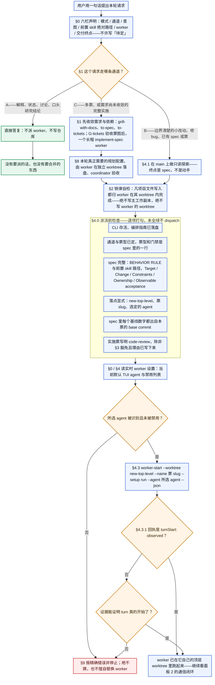
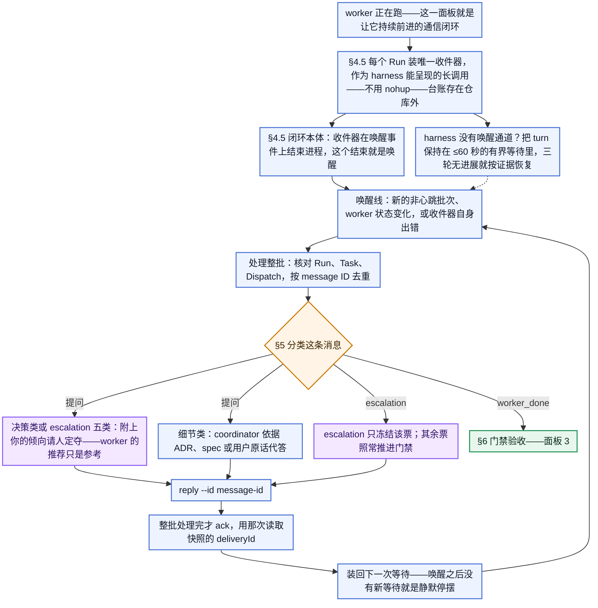
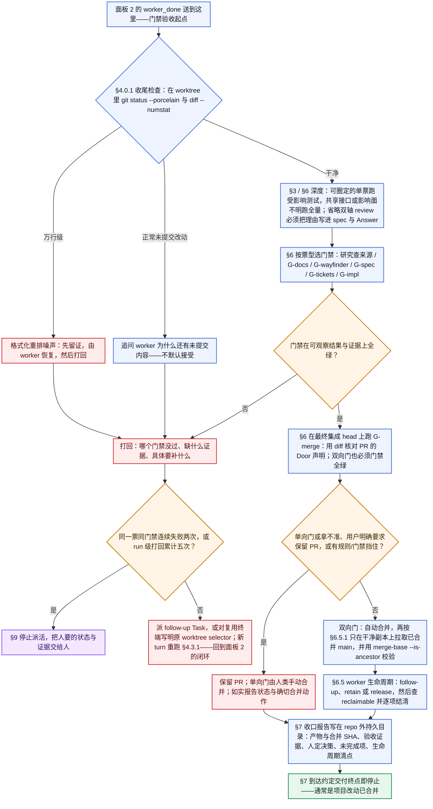
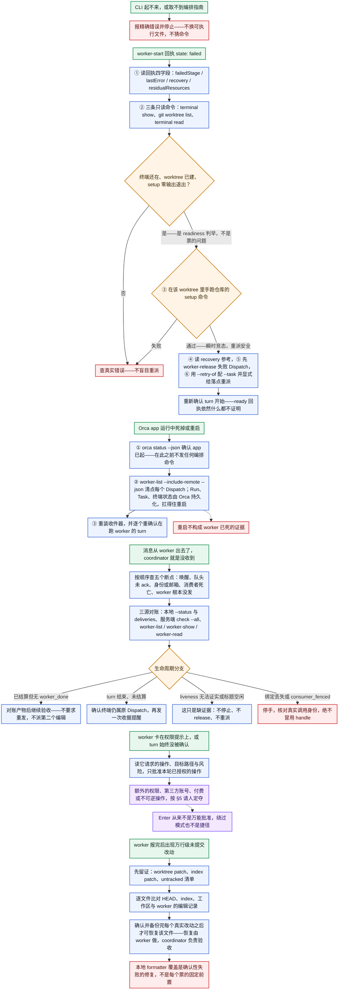

# orchestra-auto

用 Orca 协调 supervised workers，把已授权的开发或规划工作推进到验收与自动合并的一套工作流。

本仓库发布**两个可安装的 Agent Skill**，同一套流程、两种语言：

| Skill | 语言 | 安装 |
| --- | --- | --- |
| [`orchestra-auto`](skills/orchestra-auto/SKILL.md) | English | `npx skills add whutlichao/orchestra-auto --skill orchestra-auto` |
| [`orchestra-auto-zh`](skills/orchestra-auto-zh/SKILL.md) | 简体中文 | `npx skills add whutlichao/orchestra-auto --skill orchestra-auto-zh` |

英文说明见 [README.md](README.md)。

> **Orca 专用前提。** 两个 skill 都驱动 **Orca CLI**（`orca orchestration …`）。它们不是通用的
> agent 编排层，未安装 Orca 或 CLI 不可达时无法工作。安装前请先读
> [前提与能力边界](#前提与能力边界)。

## 它做什么

coordinator 负责规划、通信与验收；worker 负责编辑、提交与创建 PR。门禁通过后由 coordinator
合并——不再逐张票据请人确认。完整票图交给一个长程 `implement-spec` worker：它让 implementer
在各自 worktree 实施，合入 integration branch，只开一个集成 PR。PR 的 Merge Danger 决定最后
一步：双向门在 G-merge 通过后自动合并，单向门保留给人类手动合并。流程错误（不是产品 bug）
产出只读 retro 候选单，由人类选定后 worker 再落地。

skill 不会拿来交换的安全不变量：

- **隔离**：每个 worker 都有自己的顶层 worktree；长程 worker 的嵌套 implementer 各有自己的
  worktree 与分支；coordinator 绝不在 worker 的 worktree 里编辑或提交，也绝不在主工作副本上这么做。
- **真实启动证据**：`state: ready` 不等于 turn 已开始；skill 要求按 agent 取得实际证据（或回执的
  `turnStart: observed`）。
- **实时 worker 设置**：worker harness 来自 Orca 的当前设置，并与当前禁用列表比对——不凭习惯、
  不读过期快照。
- **消息身份**：投递按 delivery ID 原子落盘、按 ID 去重，且只有在整批处理完之后才 ack。
- **决策问人**：范围、方案分叉与 escalation 五类（凭证、第三方、付费、人工审批、不可逆
  live 数据操作）绝不代答。单向 Merge Danger 门也必须由人类合并，不自动合并。
- **门禁按票型**：设计票不跑源码测试；实施票不跳过自己的 review。
- **先验收后合并**：合并等门禁；异常 diff 先留证，再谈处理。门要用 diff 核对，不能只信 PR 正文。
- **流程错误留痕**：retro 候选单存在目标仓库之外，经人类选定后才由 worker 落地。
- **失败有停止阈值**：有界重试、单票熔断与 run 级熔断。
- **生命周期收尾**：已结算 worker 被 release、retain 或派 follow-up Task——没有静默遗弃。

## 全流程（端到端）

四个面板，按顺序读就是完整流程。蓝色是流程步骤，橙色菱形是判定，紫色是要人来定夺的地方，绿色是本轮
终点或某条恢复流程的起点，红色是失败与打回，淡色底框是下一步之前必须全绿的打勾清单。

### 1 · 把 worker 派起来（§0–§4.4）

用户一句话的请求，要变成一个跑在独立顶层 worktree 里的 worker。没有 turn 启动证据，下面任何一步都到
不了。



### 2 · 通信闭环（§4.5–§5）

最容易做错的一段：coordinator 不是在轮询，而是在被唤醒——收件器**结束进程**就是唤醒。处理批次与装回
下一次等待是一步，提问先分类再决定谁来答。



### 3 · 验收、合并与收尾（§6–§7）

`worker_done` 不等于验收通过：先跑收尾检查，再按票型选门禁，只有全绿才进入合并。同一票同门禁连续失败
两次暂停该票；跨票打回累计五次暂停整个 run。



### 4 · 失败分支（§9）

失败不是一个节点：每个入口都有自己的处置流程，而它们的共同形状是——先取证、再决定、报精确错误、绝不
无条件 relaunch。



## 安装

两个 skill 都用社区 [`skills` CLI](https://github.com/vercel-labs/skills) 安装
（`npx skills add …`）。按需要选语言版本；它们是两个独立包，不是互备的翻译兜底，团队双语的话
两个都装也可以。

```bash
# English
npx skills add whutlichao/orchestra-auto --skill orchestra-auto

# 简体中文
npx skills add whutlichao/orchestra-auto --skill orchestra-auto-zh
```

加 `--global` 装到用户级而不是当前项目，加 `--agent <name>` 指定目标 agent：

```bash
npx skills add whutlichao/orchestra-auto --skill orchestra-auto --global --agent claude-code
```

也可以从本仓库的本地检出安装**两个**变体：

```bash
git clone https://github.com/whutlichao/orchestra-auto
npx skills add ./orchestra-auto --skill orchestra-auto --skill orchestra-auto-zh
```

`orca skills install` 是 Orca 自己对同一条 `npx` 命令的封装，但它只覆盖 Orca 本地注册表里的那些
skill。跑 `orca skills install --skill orchestra-auto` 会报 `Unknown skill`——这两个包不在那个注册表
里；本仓库请用上面的 `npx skills add` 命令。

### 安装这条命令做了什么、没做什么

- **GitHub 是来源。** skill 内容住在本仓库，CLI 在安装时从 GitHub 读取，不会把你机器上的东西
  上传。
- **安装由 `skills` CLI 完成，不是本仓库。** 这条命令就是社区 CLI 去拉一个公开仓库，这里没有
  投稿步骤，也没有审核队列。
- **skills.sh 是自行聚集的目录。** 按
  [skills.sh FAQ](https://skills.sh/docs/faq)，只要有人运行安装命令，仓库就会通过匿名安装遥测
  自动出现在排行榜上——不存在面向作者的投稿表单。**因此本 README 不声称本仓库已收录在
  skills.sh 上**，任何人也不能替项目做这个声明：收录是真实安装带来的可观察结果，不是作者提交
  的动作。当前状态可以自己看：`https://skills.sh/whutlichao/orchestra-auto`。
- **遥测是排名输入，且可退出。** CLI 上报的是聚合安装遥测，其中包含公开仓库与 skill 标识；按
  skills.sh FAQ，它不携带个人信息或设备信息。`DISABLE_TELEMETRY=1` 与 `DO_NOT_TRACK=1` 可以关掉
  （CLI 文档所列）。在自己机器上设置其中任意一个都没问题，不影响本仓库。任何人都不要为了刷一个
  数字去安装。
- **本仓库不带加载脚本。** 这两个 skill 是 Markdown 说明加一个仅用标准库的 Python 脚本；
  安装本身不执行任何东西。

## 前提与能力边界

这两个 skill 是 **Orca 专用**的。装之前请读这一节。

| 要求 | 说明 |
| --- | --- |
| Node.js 与 `npx` | 社区 `skills` CLI 通过 `npx` 运行，安装命令需要本机装有 Node.js。除此之外本仓库不需要 Node。 |
| Orca | 已安装 [Orca](https://www.onorca.dev/) 且 CLI 可达。skill 会调用 `orca orchestration worker-start`、`check`、`send`、`reply`、`worker-release` 等。 |
| Orca CLI 可执行文件 | 按 Orca 文档的方式解析：`ORCA_CLI_COMMAND` → 平台二进制名 → `orca`。 |
| Orca 的 `orchestration` 指南 | skill 要求 coordinator 用 `orca skills get orchestration` 取回它，并以**实时**指南为准，而不是以 skill 自己的叙述为准。 |
| worker agent | 你的 Orca profile 已启用的那些 TUI agent。skill 读取当前默认值与当前禁用列表，而不是写死某一个。 |
| Python 3 | 仅用于可选的内置收件循环（只用标准库：POSIX 文件锁，故限 macOS/Linux/WSL）。 |

**能力边界。** 这套流程是针对 Orca 的 orchestration 动词写的。其中的判断——通道选择、门禁选择、
决策分类——是可以迁移的，别的编排器也能借鉴；但*命令*不可移植，skill 也不会假装它可以。
如果你的 CLI 不提供 `orca orchestration`，这个 skill 不适合你。

凡是涉及版本相关细节的地方（具体的设置文件、回执字段名），skill 刻意指向**当前** CLI help 与
**当前** Orca 指南，而不是写死某个值；并明确要求 coordinator 在计划用的命令与公开文档不一致时，
带证据提问，而不是猜。

## 验证

仓库用 `python3 -m unittest discover` 检查，跑两个套件。不联网、不需要凭证、不依赖任何特定机器：

```bash
python3 -m unittest discover -s tests -v
```

- `tests/test_inbox_loop.py` 用一个桩 CLI 驱动真实的收件脚本，断言那些安全关键行为：原子落盘、
  重读时内容完整、重复 delivery 不覆盖首次读取、只有 heartbeat 的批次才 ack（普通批次与混合
  批次不 ack）、CLI 错误显式失败而不是伪装成空队列、以及单消费者文件锁。它还钉住唤醒契约——
  新落盘的非心跳批次要以一行可解析 stdout 结束进程，纯心跳批次不能，worker 状态变化要——并覆盖
  原生 `check --wait` 路径、其 stderr keepalive，以及超时后重新装上等待。
- `tests/test_package_content.py` 检查包本身：两个语言变体结构一致、frontmatter 合法且 `name`
  与目录一致、所有相对链接可解析、随包发布的每个 reference 都可达并声明了自己的触发条件、
  eval JSON 的形状与唯一性、`eval.yaml` 白名单、Python 的 `py_compile`、shell wrapper 的
  `bash -n`、MIT 许可，以及脱敏扫描。

已记录结果为 **78 OK（1 skipped）**。这是主要的结构与行为门禁。

想单独跑某一条也可以：

```bash
python3 -m py_compile skills/*/scripts/inbox-loop.py
bash -n skills/*/scripts/inbox-loop.sh
python3 -c "import json,glob;[json.load(open(p)) for p in glob.glob('skills/*/evals/*.json')+['skills.sh.json']]"
```

### 按需加载与激活成本

按 Agent Skills 约定，宿主会在 skill 激活时注入完整的 `SKILL.md`；只有路由表指示时，才读取
`references/` 下的文件。[PR #2](https://github.com/whutlichao/orchestra-auto/pull/2) 将派发循环细节移至
`references/dispatch-loop.md`，将回复细节移至 `references/reply-protocol.md`。始终加载的入口文件保留
路由表与硬规则，包括 `--worktree new-top-level`、显式 `--agent`、`state:ready` ≠ `turnStart`，以及派发前的
`worker-start --help` / 注册表确认。

与精简前的提交 `fbb09b9` 相比，入口文件大小如下：

| 变体 | `SKILL.md` 字节数 | 估算 token（字节 ÷ 4）|
| --- | ---: | ---: |
| 英文 | 30,208 → 20,287（−32.8%） | 7,552 → 5,071 |
| 中文 | 24,359 → 15,963（−34.5%） | 6,089 → 3,990 |

这里的 token 节省**口径是字节数 ÷ 4**，不是 tokenizer 实测。细节仍保留在 references 中，因此整个包的字节总量
几乎不变。如果某一轮同时读取两个新 reference，激活时的节省不等于整轮的节省。

### 自动脱敏扫描

`tests/test_package_content.py` 里的 `LeakScanTests` 是脱敏检查的自动化部分。它扫描每个已发布的
文本文件，找那些绝不能出厂的形态：主目录绝对路径、某个具体的 profile 数据库文件名、凭证类变量名，
以及 token 字面量。有四点和模式本身同样重要：

1. **不写下任何私有字面量。** 扫描器只持有通用**形态**，绝不写具体的私有仓库名、账号名或凭证变量名
   ——把那些写进一个公开扫描器，等于公开了扫描本来要挡住的标识本身。精确值走带外核验：
   `PRIVATE_IDENTIFIERS=<a,b,c> python3 -m unittest tests.test_package_content` 会拿你给的值跑同一套
   扫描。没有这个变量时该用例会 **skip** 并说明原因，因此绝不会被误当成它并不具备的覆盖。
2. **可解释。** 每条例外都按**（文件，模式）对**授予，不按文件授予。整文件豁免会连带免掉路径、凭证
   与 token 检查——脱敏扫描正是这样悄悄失去对「最常被编辑的那些文件」的覆盖的。测试断言：唯一
   自我豁免的文件是扫描器自身源码、每条豁免都对应一个确实出现在那里的模式、且被豁免文件里出现
   其他模式仍会失败。
3. **不误报。** 收件脚本用随机 UUID 作为临时文件名 token。
   `test_random_uuid_tokens_are_not_reported_as_credentials` 这条断言这些 UUID 不匹配任何凭证
   模式，真实发现不会被噪声淹没。
4. **通用形态仍要有牙齿。** `test_generic_credential_pattern_catches_a_realistic_secret_name` 断言
   凭证形态能匹配现实中的变量名（例如带 `_TOKEN` 或 `_API_KEY` 后缀的全大写名字）且不误伤普通文字，
   这样把字面量换成形态不会悄悄把检查变成空操作。

另有两项人工检查与它并列，且都无法从仓库内部自动化：

- **自己读一遍 diff，找任何可识别的信息。** push 之前逐文件过一遍 `git diff <base>...HEAD`。
  真正泄露在散文里的东西，往往没有任何模式预料到，靠的就是这一步。
- **核对署名面。** 版权人出现在 `LICENSE`、两个 README 与 launch kit 里是刻意的；出现在别处就是
  脱敏事故。

## 评估集

每个语言变体都带一份 `evals/evals.json`，20 个提示词层面的场景，覆盖通道判定、worker 栏取值、
启动确认、门禁选择、review 安排、打回判断、决策分类、升级、合并例外，以及「先唤醒、再重装」的契约。

这些是**场景检查，不是端到端证明**：它们看的是一个读过本 skill 的 agent 是否按 skill 的意图推理，
并不证明编排在真实 Orca 主机上能跑通——那是脚本行为测试和真实使用的事。每份文件都在 `_note`
里写明同样的保留，且没有任何场景假设某台特定机器：没有主目录路径、没有私有仓库或票据名、
没有本机 agent 偏好、也没有任何主机的设置快照。像「这台机器默认用哪个 agent」这样的场景，
一旦写进公开评估集就等于泄露本仓库刻意排除的数据；所以场景考的是**推理**（去读实时设置、
不要猜），而不是某个值。

## 仓库结构

```text
.
├── LICENSE                     MIT，版权 2026 whutlichao
├── CONTRIBUTING.md             如何改动这些包
├── SECURITY.md                 什么算这里的安全问题
├── README.md                   English README
├── README.zh-CN.md             本文件
├── skills.sh.json              skills.sh 目录页的分组配置
├── skills/
│   ├── orchestra-auto/         英文包
│   │   ├── SKILL.md            路由与核心约束
│   │   ├── references/         按条件读取的细节，9 个文件
│   │   ├── scripts/            可选的收件循环
│   │   ├── evals/evals.json    提示词层面的场景
│   │   └── eval.yaml           可选的外部 skill runner 用例
│   └── orchestra-auto-zh/      中文包，结构相同
│       └── …
├── launch-kit/                 定位、demo 讲稿、FAQ、各渠道草稿
└── tests/                      上面的 unittest 套件
```

## 状态与范围

- 这套流程对**过程**有主张，对你的产品没有：它不会替你决定做什么，拿不准就升级而不是猜。
- `launch-kit/` 下的发布材料是**草稿**。它们存在的意义是让维护者在审阅后自己发出去。准备这些
  材料不涉及登录账号、不接触社区、不代为发帖。
- 本仓库只放已发布的包、它们的检查与文档，不含 Orca 本身。

## 致谢

本仓库的监督式协作与 Agent Skills 流程，灵感来自 [Matt Pocock 公开的 agent skills](https://github.com/mattpocock/skills)
及其相关工程实践思路。本仓库将这些思路落地到 Orca（`orca orchestration`），由本仓库自行实现并适配；Matt Pocock 未参与本项目的开发或维护，也未为本项目背书。可参阅 [Matt Pocock 的 GitHub 个人资料](https://github.com/mattpocock)。

## 许可

[MIT](LICENSE)，版权 2026 whutlichao。欢迎贡献，见 [CONTRIBUTING.md](CONTRIBUTING.md)。
